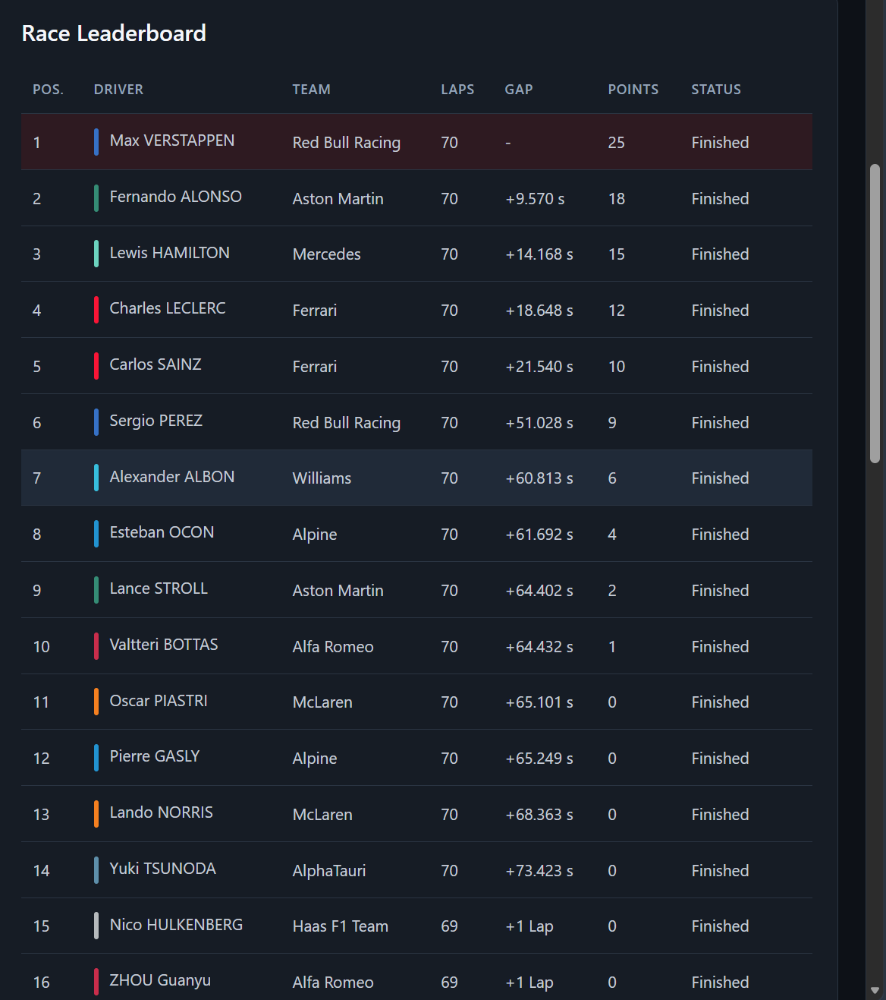
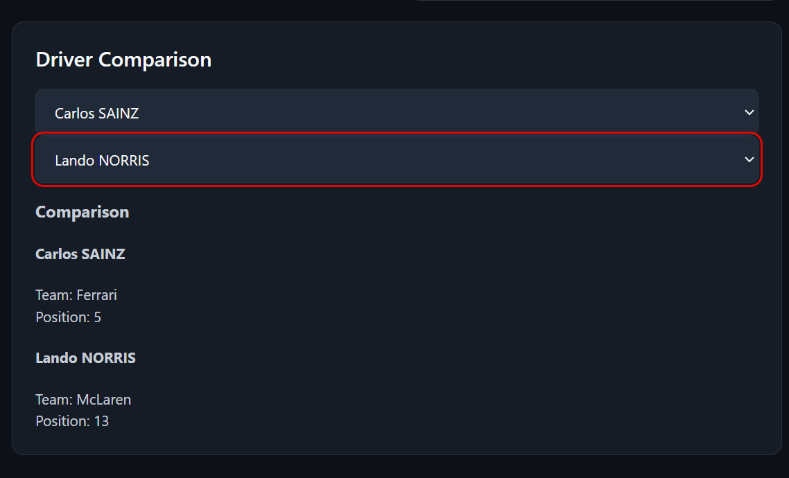

# F1 Trackside 🏎️

**The fastest way to understand a Formula 1 weekend.**


**[Live Demo](https://f1-trackside-zeta.vercel.app/)**

## Screenshots

### Race Leaderboard


### Driver Comparison


## How It Works

1. Users select a Formula 1 meeting.
2. Available sessions are retrieved from the OpenF1 API.
3. Selecting a session triggers requests for driver and session data.
4. The dashboard processes the returned data and displays race results, standings, and driver comparisons.

## Features

- **Race Selection:** Browse Formula 1 meetings across multiple seasons.
- **Session Selection:** Select available sessions, including practice, qualifying, and race sessions.
- **Race Leaderboard:** View driver finishing positions, teams, and points.
- **Driver Standings:** Explore the drivers' championship standings.
- **Constructor Standings:** Compare teams based on championship points.
- **Driver Comparison:** Compare driver performance using session data.

## Tech Stack

- React
- JavaScript
- Vite
- CSS
- OpenF1 API

## Data Source

F1 Trackside uses the [OpenF1 API](https://openf1.org/) to retrieve Formula 1 data, including race meetings, sessions, driver information, race results, and championship standings.

API requests are managed through a shared request queue to help control request frequency and reduce rate-limit errors.

## Technical Challenges

- Managing API request frequency to reduce rate-limit errors.
- Processing session results and matching driver information.
- Handling different driver result statuses, including DNFs and lap gaps.

## Getting Started

### Prerequisites

- Node.js
- npm

### Installation

1. Clone the repository:

   ```bash
   git clone https://github.com/ayata30/f1-trackside.git
   ```

2. Navigate into the project directory:

   ```bash
   cd f1-trackside
   ```

3. Install dependencies:

   ```bash
   npm install
   ```

4. Start the development server:

   ```bash
   npm run dev
   ```

5. Open the local URL provided by Vite in your browser.

## Future Improvements

- AI-powered race weekend summaries.
- Improved classification and driver status information, including DNFs. 🟢
- Email notifications for race updates.
- Additional driver performance insights.
- F1 dictionary
- Improve standing page
- Add Race Calendar

## Acknowledgments

- [OpenF1](https://openf1.org/) for providing Formula 1 data.

---


